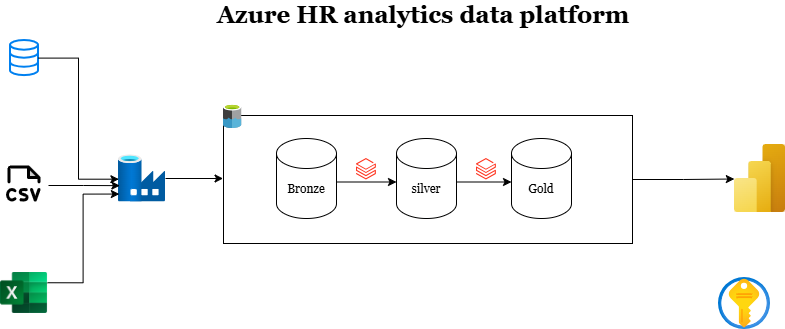

# Azure HR Analytics Data Platform

An end-to-end HR analytics pipeline: mock employee data is generated locally,
ingested from three different source formats, cleaned through a medallion
architecture on Azure, and modeled into analytics-ready dimensional tables in
Unity Catalog.



*(Diagram: PostgreSQL / CSV / Excel sources → ADF (self-hosted IR) →
raw → silver → gold → Power BI, with a key icon representing
identity-based access throughout — no storage keys or embedded secrets.)*

## How the pipeline flows

1. **Mock data generation** (local) produces three source formats that mirror
   a real HR system's typical fragmentation: a relational table, a CSV
   export, and an Excel report.
2. **Azure Data Factory**, via a self-hosted integration runtime, copies the
   PostgreSQL `employees` table into ADLS Gen2 `raw/`. The CSV and Excel
   files are uploaded to `raw/` directly (not through ADF).
3. A **blob event trigger** fires when a new performance file lands in
   `raw/performance/`, kicking off the pipeline.
4. The pipeline runs two **Databricks notebooks** in sequence:
   `01_raw_to_silver` then `02_silver_to_gold`.
5. Gold tables are registered in **Unity Catalog** and consumed by Power BI.

## Medallion layers

| Layer | Contents | Produced by |
|---|---|---|
| **Raw (bronze)** | Unmodified source data: `employees/`, `attendance/`, `performance/` | ADF copy activity (employees) + manual/CSV-Excel upload |
| **Silver** | Cleaned, standardized, deduplicated Delta tables — normalized departments/text, parsed salary and hire dates, integer `EmployeeID`, cleaned performance scores/dates/comments/attendance fields | `01_raw_to_silver` notebook |
| **Gold** | Star schema: `dim_employee`, `fact_attendance`, `fact_performance`, with year/quarter/month attributes for reporting. Orphan `EmployeeID` foreign keys are checked before writing. | `02_silver_to_gold` notebook |

## Repository structure

```
.
├── data_generation/          # Faker/pandas/SQLAlchemy mock data generator
├── docker-compose.yml         # Local PostgreSQL 16
├── .env.example                # Template for local DB credentials — copy to .env
├── adf/                          # ADF resources: linked services, datasets,
│                                  # pipelines, triggers (Git-integrated with ADF Studio)
├── notebooks/
│   ├── 01_raw_to_silver.py
│   └── 02_silver_to_gold.py
├── terraform/                   # Infrastructure as code (see below)
├── docs/
│   └── architecture.png       # Add the diagram here
└── output/                       # Generated data lands here (gitignored)
    ├── employees_reference.csv
    ├── attendance.csv
    └── performance_reviews.xlsx
```

## Local development

### 1. Start PostgreSQL
```bash
cp .env.example .env    # fill in local DB credentials — never commit .env
docker compose up -d
```
PostgreSQL 16 runs in Docker, data persisted in a Docker volume, container
port `5432` mapped to host port `5433`. Config is read from `.env`.

### 2. Generate mock data
```bash
pip install -r requirements.txt

# Standard run
python data_generation/script.py --num-employees 20

# Clean data, no injected quality issues
python data_generation/script.py --num-employees 20 --messy-rate 0

# Skip loading into Postgres (CSV/Excel only)
python data_generation/script.py --num-employees 20 --skip-postgres

# Larger volume for performance testing
python data_generation/script.py --num-employees 100000
```
`--messy-rate` controls how much of the data gets deliberately corrupted:
inconsistent salary/date formats, casing/whitespace issues, missing values,
invalid attendance values, `EmployeeID` format variants, and duplicate
employee rows — used to exercise the cleaning logic in `01_raw_to_silver`.

Output lands in `output/`: `employees_reference.csv`, `attendance.csv`,
`performance_reviews.xlsx`.

### 3. Stop / reset
```bash
docker compose down       # stop containers, keep data
docker compose down -v    # also remove the Postgres volume
```

## Azure deployment

### Prerequisites
- An Azure subscription with rights to create resource groups, storage,
  Data Factory, and Databricks (Premium SKU)
- Azure CLI logged in (`az login`) — Terraform and the Databricks provider
  both authenticate through your Azure credentials, no separate PAT needed
- A machine reachable from your PostgreSQL instance, to host the
  self-hosted integration runtime agent

### Terraform
Provisions:
- Resource group, ADLS Gen2 storage account with `raw`/`silver`/`gold`
  containers
- Azure Data Factory instance
- Self-hosted integration runtime *registration* (see manual step below)
- Premium Databricks workspace + Access Connector (managed identity)
- Storage role assignments (identity-based access only — no account keys)
- Unity Catalog storage credential + external locations (`raw`, `silver`,
  `gold`)
- A single-node Databricks cluster with the Spark Excel Maven dependency

```bash
cd terraform
cp terraform.tfvars.example terraform.tfvars   # edit values
terraform init
terraform plan
terraform apply
```

Default region is `westeurope`. **Remote state is not enabled by
default** — this uses local state. Set up a remote backend before
treating this as a shared/team environment.

**Manual steps Terraform can't do:**
- Install and register the self-hosted integration runtime agent on a
  machine that can reach PostgreSQL (`terraform output -raw
  shir_auth_key_1` gets you the registration key)
- Confirm a Unity Catalog metastore is assigned to the workspace —
  required before the storage credential/external locations can be
  created; not guaranteed to exist automatically for a from-scratch
  workspace

### ADF configuration
ADF resources — linked services, datasets, pipeline and trigger
definitions — live under `adf/` via ADF Studio's Git integration, not in
Terraform. Some of this JSON contains environment-specific values
(storage account names, workspace paths, identities) that will need
updating if you're pointing this at your own Azure resources rather than
redeploying the exact same names.

### Databricks notebooks
`01_raw_to_silver` and `02_silver_to_gold` are triggered by the ADF
pipeline, but can also be run manually against the provisioned cluster
for development/debugging. Like the ADF JSON, notebook paths and any
hardcoded storage account references may need updating to match your
environment.
